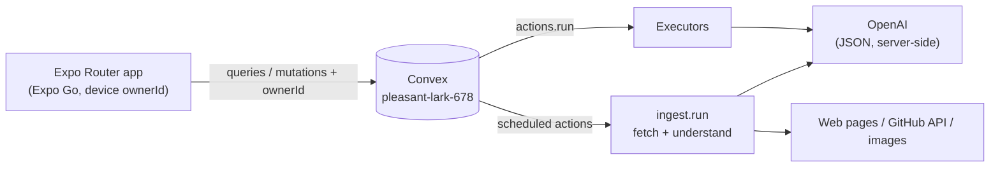

# Zapy

**Turn what you save into what you do.**

Zapy is an iOS-first app for the things you save and never come back to: a scholarship post, a GitHub repo, a restaurant link, a design screenshot. You save it, Zapy reads the source and works out what it is, then offers three actions that fit that kind of content and runs them into a real, saved result. Phase 2 (Social Studio) turns a save or a new photo into platform-specific post drafts that you copy, share, or post directly to LinkedIn and X when their keys are set.

Built with Expo SDK 58, Expo Router, Convex and OpenAI (server-side only). The live demo runs on a real iPhone through Expo Go.

More detail: [docs/architecture.md](docs/architecture.md), [docs/limitations.md](docs/limitations.md), [docs/demo-script.md](docs/demo-script.md).

## Features

### Phase 1: Save → Understand → Act (on main)

- **Capture** (modal, Link | Text | Photo). Paste a URL, paste text, or pick or take photos (resized to 1600px JPEG before upload). Links are validated, and an invalid one offers "Save as text instead" or "Edit link". A "Try an example" row prefills a GitHub repo, a scholarship text and a restaurant link, which still go through real analysis.
- **Understand.** A Convex action fetches the source (web page, GitHub REST plus raw README, image via vision, or the pasted text), then OpenAI classifies it into one or more of 14 content types and extracts key facts (deadline, location, price, organization). Every fact keeps its evidence quote, and facts not found in the source are reported as missing, never guessed. Status moves through Understanding… → Ready, Needs info or Failed.
- **Act.** Each content type gets three contextual actions, for example Scholarship: Check eligibility, Prepare application, Track verified deadline; GitHub: Understand project, Extract setup guide, Prepare integration plan; Restaurant: Plan a visit, Find location, Prepare invitation; Design: Extract style, Create design brief, Add to moodboard. Executors check every cited quote against the fetched source and drop what doesn't match, with a warning on the result.
- **Results** render as checklists (toggles persist), steps, lists, key-value rows and text, with warnings, sources, Copy and Share. They are reopenable from item detail, Home and Activity.
- **Screens:** Home (Save, Ready for you, Recently saved, Completed outcomes), Library (search, type filters, retry), Item detail (facts with evidence, "Needs more info" banner with Add screenshot / Paste text), Contextual Actions (inputs prefilled from Profile, confirmation for approval-gated actions), Action Results, Activity, and Profile (details used by eligibility and visit planning, stats, About & limitations).

### Phase 2: Social Studio (on main)

Reached from the **Create** tab or **Create post** on any saved item.

- **Composer + platform adapters:** distinct LinkedIn, X, Instagram, TikTok and Threads drafts from one brief built from a saved item or a new photo, stored as versioned drafts. Facts (with source) are kept separate from creative text and shown as "Facts used", and wording stays truthful ("Found this restaurant and want to try it", never "I had the best dinner here"; a bookmarked repo is never one you built).
- **Editor:** one tab per platform with Save edit, Rewrite, Copy, Preview and Share. A user edit is saved as a new version, and rewriting one platform never touches another platform or earlier edits.
- **Photo flow:** Create → New photo → pick or take a photo, add optional context → Create drafts. The photo is analyzed, then you get an Instagram caption and a TikTok storyboard (hook, shots, voiceover, on-screen text, caption).
- **Publishing:**
  - **LinkedIn and X post directly when their keys are set on the Convex deployment.** LinkedIn needs `LINKEDIN_ACCESS_TOKEN` (and optionally `LINKEDIN_PERSON_URN`); X needs `X_API_KEY`, `X_API_SECRET`, `X_ACCESS_TOKEN` and `X_ACCESS_TOKEN_SECRET`. On the dev deployment LinkedIn is configured and a real test post succeeded (`urn:li:share:7527842989080018944`); X stays in share-sheet mode until its four keys are set.
  - Share on a connected platform opens a sheet with **Confirm and publish**. A draft is marked Published only when the provider returns a post id, and the sheet then offers "View on LinkedIn".
  - **Instagram, TikTok and Threads always use the share sheet** (Open in / Share to, then "I posted it"). "I posted it" is recorded as user-reported, never as Published.
  - Statuses: Draft, Ready to share, Awaiting user action, Publishing, Published, Failed.
  - **Profile → Connected accounts** shows Connected or Share-sheet mode per platform, and **Send test post** on a connected LinkedIn or X account posts "Testing Zapy <time>" and shows the returned post id.

## Architecture



- **App:** routes live in `src/app` (four tabs plus the Capture modal, item detail, actions and result screens). Shared shapes are in `src/shared/contracts.ts`; the design tokens are in `src/theme` and the UI kit in `src/components/ui`.
- **Convex:** 9 Phase 1 tables (`users`, `savedItems`, `contentAnalysis`, `actionSuggestions`, `actionExecutions`, `actionResults`, `collections`, `activityEvents`, `userPreferences`). Public functions live in `items`, `actions`, `analysis`, `activity`, `collections`, `preferences` and `users`; ingestion and executors are internal actions. Phase 2 adds 6 tables from `convex/social/schema.ts` and `api.social.drafts.*`.
- **OpenAI** is called only from Convex actions through `convex/lib/llm.ts` (`callLLMJson`), in JSON mode, with the model from `OPENAI_MODEL`.
- **Identity:** there is no login. `src/identity/OwnerProvider.tsx` creates a UUID once (expo-crypto) and keeps it in expo-secure-store, with a file fallback where the keychain is unavailable. Every public Convex function takes `ownerId`; use `useOwnedQuery(api.x.y, args)` and `useOwnedMutation(api.x.y)`, which inject it. On the server, resolve it with `convex/lib/auth.ts` (`requireUser`, `requireOwnedItem`, `requireOwned`) before touching data.

See [docs/architecture.md](docs/architecture.md) for the full pipeline.

## Run

```bash
npm ci
npx expo start          # scan the QR code with the iPhone camera to open it in Expo Go
```

`.env` holds the only committed env value, the public `EXPO_PUBLIC_CONVEX_URL=https://pleasant-lark-678.convex.cloud`, so the app talks to the shared dev deployment with no extra setup. Checks: `npx tsc --noEmit` and `npx expo lint`.

Backend changes are pushed with `npx convex dev --once` (needs `CONVEX_DEPLOY_KEY`). That command replaces the whole function set on the shared deployment, so deploy only from `origin/main` merged with every in-flight Convex branch. Server-side env on the deployment: `OPENAI_API_KEY`, `OPENAI_MODEL` (gpt-5.4-mini), and optionally `GITHUB_TOKEN`. The app never calls OpenAI directly.

## Limitations

- No login: saves belong to one device's ownerId, so deleting the app or switching phones loses access.
- Direct posting covers LinkedIn and X only, from one deployment-wide account set by server env keys (LinkedIn is configured on dev; X stays in share-sheet mode until its four keys are set). Instagram, TikTok and Threads go through copy or the share sheet. Nothing is marked Published without a provider post id.
- Without `GITHUB_TOKEN`, the GitHub API rate-limits; the app falls back to the raw README and loses stars, license and last-push data.
- Instagram, TikTok and other login-walled links can't be read; the item goes to Needs info and asks for a screenshot or pasted text.
- Facts missing from the source (a deadline, a price, an address) are reported as missing, not guessed. AI output can still be wrong; check it before you act on it.

Full list: [docs/limitations.md](docs/limitations.md).

## File ownership (parallel threads)

Edit only the files your thread owns. Shared types change only through `src/shared/contracts.ts` (Phase 1) or `src/shared/socialContracts.ts` (Phase 2), via the Captain, and only additively.

| Owner | Files |
| --- | --- |
| Lead | `src/shared/contracts.ts`, `convex/schema.ts` (Phase 1 tables), `convex/lib/validators.ts`, `convex/lib/auth.ts`, `convex/items.ts`, `convex/users.ts`, `src/identity/**`, `src/theme/**`, `src/components/ui/**`, `app.json`, `package.json` |
| A — UI/UX | `src/app/**`, `src/components/**` except `src/components/ui` |
| B+C — ingestion + understanding | `convex/ingest.ts`, `convex/analysis.ts`, `convex/lib/llm.ts`, `convex/lib/sources.ts` |
| D+E — routing + executors | `convex/lib/actionCatalog.ts`, `convex/actions.ts`, `convex/lib/executors/**` |
| F — backend | `convex/activity.ts`, `convex/collections.ts`, `convex/preferences.ts` |
| H+I — composer + adapters (Phase 2) | all Phase 2 schema (`convex/social/schema.ts`: socialDrafts, socialDraftRevisions, mediaAssets, platformConnections, publishingJobs, publishingResults), `convex/social/validators.ts`, `src/shared/socialContracts.ts`, `convex/social/**` |
| Photo flow (Phase 2) | `mediaAssets` upload/analyze functions (e.g. `convex/mediaAssets.ts`); writes `mediaAssets` rows |
| J — publishing + share (Phase 2) | `convex/publishing/**`, `src/lib/share.ts`, `src/components/publishing/**` |
| K — Social Studio screens (Phase 2) | `src/app/studio/**`, `src/components/studio/**` |
| Docs | `README.md`, `docs/**` |

Schema changes by other threads: new optional fields or new indexes only, coordinated through the Captain. New dependencies: `npx expo install`, Expo Go-compatible only, and tell the Captain since `package.json` is shared.

## Integration points

- **Ingestion (B+C):** `items.create` and `items.retry` schedule `internal.ingest.run({ itemId })`. It reads with `internal.items.getForProcessing`, writes status and understood fields with `internal.items.setExtraction` (keeps Library search text in sync), stores the `ContentAnalysis` in `contentAnalysis`, then schedules `internal.actions.suggestForItem` to create the three `actionSuggestions`.
- **Checklist toggles:** `api.items.setChecklistItem({ resultId, sectionIndex, itemIndex, checked })` (Lead, in `convex/items.ts`) persists `checked` on checklist items and steps; every other `actionResults` write belongs to D+E.
- **Key facts:** `sourceAccessible`, `missingInfo`, `deadline` (YYYY-MM-DD), `location`, `price`, `organization` exist on both `contentAnalysis` and `savedItems`; B+C set the item copy through `internal.items.setExtraction`.
- **Actions (D+E):** `actionsForType(primaryType)` from contracts gives the three actions. `api.actions.execute` schedules `internal.actions.run`; executors return an `ActionResultDocument` stored in `actionResults.result`, and status lives on `actionExecutions`.
- **UI (A):** `SavedItemView` is what `items.list/get/search` return. Build screens from `src/components/ui` and `src/theme` (dark-first). Put a `testID` on every button and input a test touches.
- **Activity (F):** `internal.activity.log` records events; `api.activity.list` and `listForItem` read them.
- **Social Studio (Phase 2):** types in `src/shared/socialContracts.ts`, API in `convex/social/drafts.ts` (`api.social.drafts.*`, all take `ownerId`). Drafts have two separate statuses: `generationStatus` (generating | ready | failed, the composer's progress) and `status` (draft | ready_to_share | awaiting_user_action | publishing | published | failed, owned by J's publishing code). `update` and `regenerate` write a new revision on that draft only, so other platforms and earlier edits are kept.
