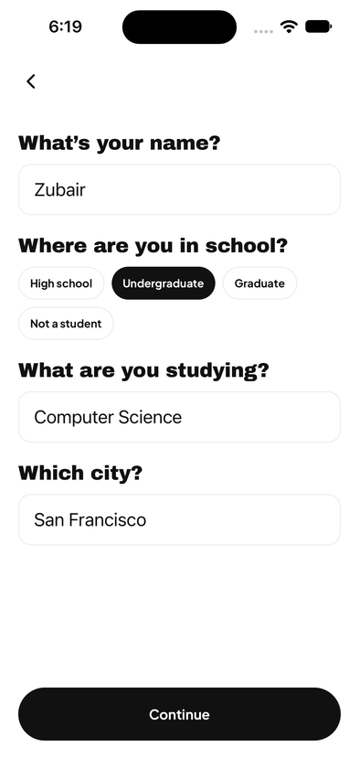
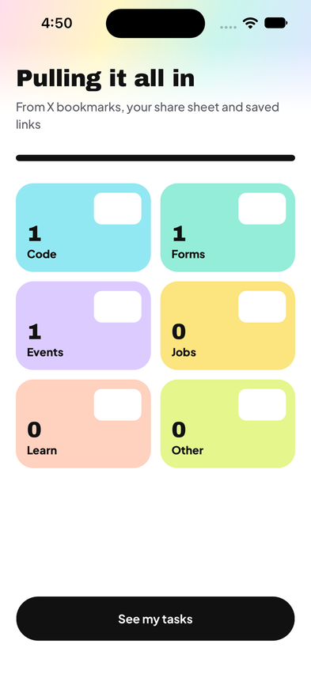
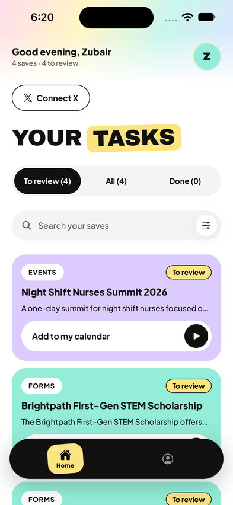
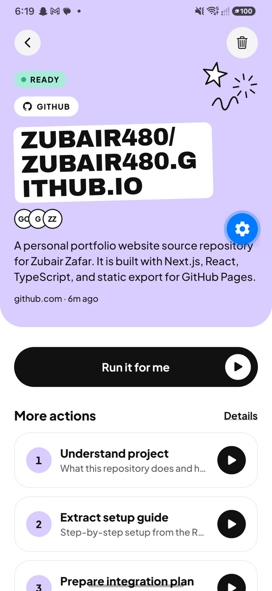
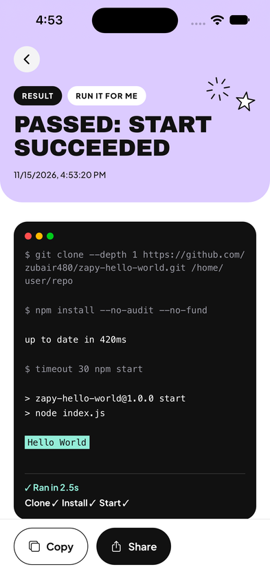
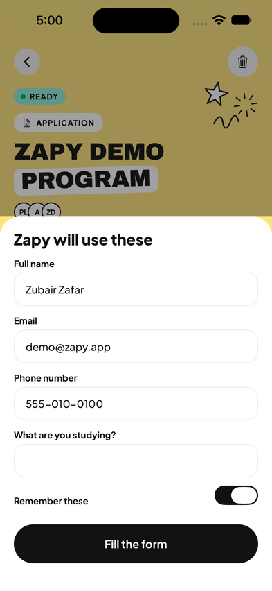
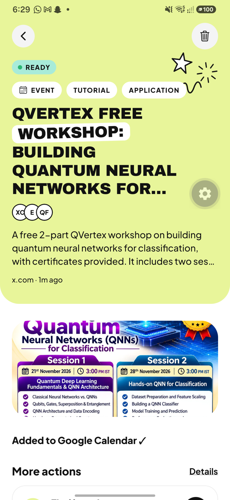
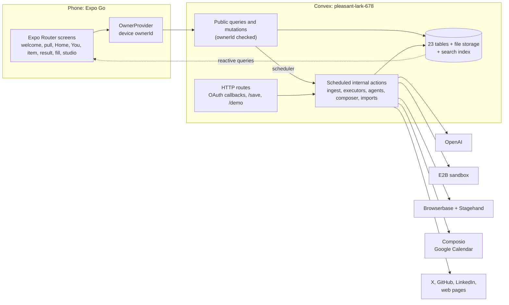
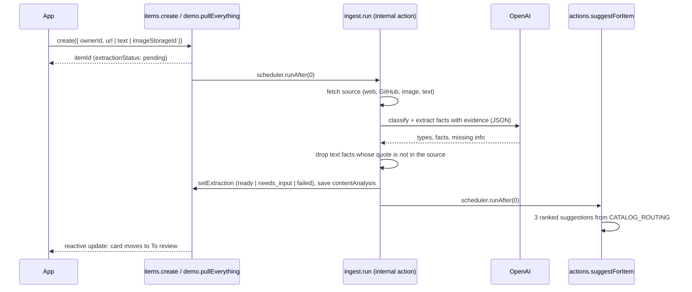
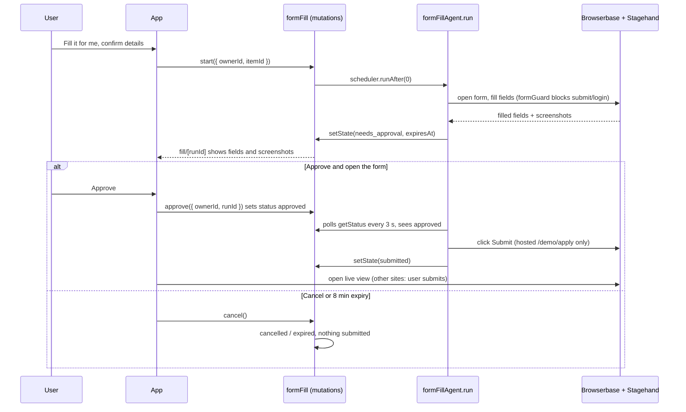

# Zapy

**Turn what you save into what you do.**

[](https://docs.expo.dev/versions/v58.0.0/)
[](https://reactnative.dev)
[](https://www.typescriptlang.org)
[](https://convex.dev)
[-412991?logo=openai)](https://platform.openai.com)
[](https://capy.ai)
[](tests/revyl/README.md)

Zapy is a mobile app (Expo, runs in Expo Go) for the things people save and never come back to: a GitHub repo, a scholarship or program application, an event post. It pulls those saves in, reads each source on a Convex backend with OpenAI, sorts it into a box (Code, Forms, Events, Jobs, Learn, Other) and turns it into a task with quoted facts and actions. For the three agent boxes it does the work itself after you approve it: it runs a repo in an E2B sandbox, fills a web form with Browserbase + Stagehand, or adds an event to Google Calendar through Composio.

Everything in this README was checked against `origin/main` at `71a633d` (2026-11-16). Things that are not on `main` are labelled **in progress**.

## Contents

- [TL;DR for agents](#tldr-for-agents)
- [Screenshots](#screenshots)
- [Problem, solution, who it's for](#problem-solution-who-its-for)
- [Demo walkthrough](#demo-walkthrough)
- [Features on main](#features-on-main)
- [Built with Capy, Revyl and Convex](#built-with-capy-revyl-and-convex)
- [Architecture](#architecture)
- [Repo map](#repo-map)
- [Getting started](#getting-started)
- [Testing and quality](#testing-and-quality)
- [Agent guide](#agent-guide)
- [Security and privacy](#security-and-privacy)
- [Limitations and roadmap](#limitations-and-roadmap)
- [Team and credits](#team-and-credits)

## TL;DR for agents

```yaml
name: Zapy
what: Expo Router mobile app + Convex backend. Saves (links, text, photos, X bookmarks, GitHub stars)
  are analyzed server-side with OpenAI into typed tasks with evidence-quoted facts and 3 contextual
  actions; GitHub / form / event saves get an approval-gated agent action (E2B, Browserbase, Composio).
stack:
  app: Expo SDK 58 (~58.0.25), React Native 0.88.1, React 19.3, Expo Router, TypeScript ~6.0, Expo Go only
  backend: Convex ^1.50 (schema, queries, mutations, actions, scheduler, file storage, search index, HTTP routes)
  ai: OpenAI from Convex actions only (convex/lib/llm.ts), model from OPENAI_MODEL, JSON output
  agents: e2b (Run it for me), @browserbasehq/stagehand (Fill it for me), Composio REST (Add to my calendar)
entry_points:
  app: src/app/_layout.tsx (providers), src/app/(tabs)/index.tsx (Home / Your tasks), src/app/welcome.tsx (start flow)
  backend: convex/schema.ts, convex/http.ts, convex/items.ts, convex/ingest.ts, convex/actions.ts, convex/demo.ts
  contracts: src/shared/contracts.ts, src/shared/socialContracts.ts (additive changes only)
commands:
  install: npm ci
  run: npx expo start            # scan the QR code with Expo Go
  run_android_usb: npx expo start --localhost --port 8082   # then: adb reverse tcp:8082 tcp:8082
  test: npm test                 # vitest + convex-test, 21 files / 185 tests
  typecheck: npx tsc --noEmit
  lint: npx expo lint
  e2e: tests/revyl/*.yaml on a Revyl cloud iPhone 16 (see tests/revyl/README.md)
convex:
  deployment: pleasant-lark-678 (shared dev)
  client_url: https://pleasant-lark-678.convex.cloud   # committed in .env as EXPO_PUBLIC_CONVEX_URL
  http_actions: https://pleasant-lark-678.convex.site
  deploy_rule: only from a clean checkout of origin/main; "npx convex dev --once" replaces ALL functions
env:
  client: [EXPO_PUBLIC_CONVEX_URL]
  server_required: [OPENAI_API_KEY]
  server_optional: [OPENAI_MODEL, GITHUB_TOKEN, E2B_API_KEY, BROWSERBASE_API_KEY, BROWSERBASE_PROJECT_ID,
    COMPOSIO_API_KEY, COMPOSIO_GCAL_AUTH_CONFIG_ID, X_CLIENT_ID, X_CLIENT_SECRET, GOOGLE_CLIENT_ID,
    GOOGLE_CLIENT_SECRET, LINKEDIN_ACCESS_TOKEN, LINKEDIN_PERSON_URN, X_API_KEY, X_API_SECRET,
    X_ACCESS_TOKEN, X_ACCESS_TOKEN_SECRET, CONVEX_SITE_URL]
identity_rule: >
  No login. The app makes a device UUID (ownerId, src/identity/OwnerProvider.tsx). Every public Convex
  function takes ownerId and checks it with requireUser / requireOwnedItem / requireOwned
  (convex/lib/auth.ts). Client code calls useOwnedQuery / useOwnedMutation, which inject ownerId.
docs: [README.md, llms.txt, AGENTS.md, docs/architecture.md, docs/limitations.md, docs/demo-script.md,
  docs/design-system.md, docs/ios-shortcut.md, docs/android-share.md, docs/youtube-import-setup.md, tests/revyl/README.md]
```

## Screenshots

Captured from `main` builds on 2026-11-15/16: Revyl cloud iPhone 16 renders, plus two shots from a phone running Expo Go (marked).

| Start flow | Pull everything | Your tasks |
| --- | --- | --- |
|  |  |  |
| One-screen questionnaire: name, school, field of study, city. | Pull everything seeds the demo saves (and syncs X when connected) and sorts them into boxes. | The task queue: To review / All / Done, search, and the two-tab Home \| You dock. |
| **Run it for me** (Expo Go) | **Run result** | **Fill it for me** |
|  |  |  |
| A GitHub save: the big agent action plus three contextual actions. | E2B cloned `zubair480/zapy-hello-world`, installed it and `npm start` printed Hello World. | The details sheet before Browserbase fills the form. |
| **Added to Google Calendar** (Expo Go, Android) | | |
|  | | |
| An event save after the approved Composio calendar write. | | |

## Problem, solution, who it's for

**Problem.** People save hundreds of posts, links and screenshots (repos to try, scholarships to apply to, events to attend) and act on almost none of them, because each one still needs reading, deciding and a chore.

**Solution.** Zapy pulls the saves in, works out what each one is, keeps only facts it can quote from the source, and turns the save into a task. Each task has three contextual actions that produce saved results (checklists, guides, briefs), and the Code, Forms and Events boxes get one agent action that does the chore after you approve it.

**Who it's for.** Students and early-career builders who bookmark opportunities and tools on X, GitHub and the web: the demo profile is a computer-science undergraduate with a GitHub repo to try, a camp and a scholarship to apply to, and a summit to attend.

## Demo walkthrough

This is the live flow on `main` (the full script with fallbacks is [docs/demo-script.md](docs/demo-script.md); the steps below are the current code paths).

1. **Intro.** The ZapMark intro plays on launch (`src/components/brand/ZapIntro.tsx`, skip with `zap-intro-skip`).
2. **Start.** On first launch Home sends a new device to `/welcome` (`src/app/welcome.tsx`). Tap **Start** (`onboarding-start`).
3. **One-screen questionnaire.** Name, where you are in school (chips), what you study, which city; **Continue** saves them with `preferences.upsert`.
4. **Complete your account.** Email and phone (used later by Fill it for me) and an optional **Connect X** (`account-connect-x`, X OAuth 2.0 PKCE).
5. **Connect your calendar.** Composio Google Calendar connect (`CalendarConnectRow`), or **Not now** (`calendar-skip`).
6. **Pull everything** (`src/app/pull.tsx`). `demo.pullEverything` seeds four demo saves (the `zapy-hello-world` repo, a camp application, a scholarship, a nurses summit post; `convex/lib/demo.ts`), schedules ingestion for each, and schedules X / GitHub syncs if connected. The six boxes count up live from `demo.pullStatus`. Tap **See my tasks** (`pull-see-tasks`).
7. **Your tasks** (`src/app/(tabs)/index.tsx`). Cards are colored by box (`src/lib/boxes.ts`), with **To review / All / Done** tabs, search once there are 3+ saves, pull-to-refresh (runs `imports.sync.syncAll`), and a **Connect X** pill while X is not connected. The dock has two tabs: **Home** and **You**.
8. **Run it for me** (GitHub save). Open the repo task and tap the big button (`task-primary-action`). `agentRuns.startRunRepo` creates a `run_repo` execution and schedules `agentMode.runRepo`, which clones the repo in an E2B sandbox, installs it and runs its start/test script. The result screen shows the terminal transcript (verified live: `npm start` printed **Hello World** on `zubair480/zapy-hello-world`). Needs `E2B_API_KEY`; without it the button is hidden (`agentRuns.runRepoAvailable`).
9. **Fill it for me** (camp / scholarship save). Tap the button, check the **Zapy will use these** sheet (name, email, phone, studying; **Remember these** saves them to your profile), tap **Fill the form**. `formFill.start` schedules `formFillAgent.run`: Browserbase opens the form and Stagehand fills it but never submits (`convex/lib/formGuard.ts` refuses submit-like and login instructions). The run stops at **needs_approval** ("Ready for your OK") with the filled fields and screenshots (`src/app/fill/[runId].tsx`), held for up to 8 minutes. **Approve and open the form** (`fill-approve`) marks the run approved and opens the Browserbase live view. On the hosted demo form `/demo/apply` the agent then clicks Submit itself (status **submitted**); on any other site it never submits, and you review and submit in the live view. **Cancel** closes the session. Verified live: a run reached needs_approval and submitted on `/demo/apply`; submissions are listed at `/demo/submissions`.
10. **Add to my calendar** (event save). `agents/calendar.prepare` drafts a proposal (title, time, timezone, duration, location) from the source and stops at **needs_approval**; you can edit it. **Approve** runs `GOOGLECALENDAR_CREATE_EVENT` through Composio; the item shows **Added to Google Calendar ✓**. A source with no date leaves the date empty and blocks approval until you fill it in.
11. **Social Studio drafts.** On any item, **Create post** (`create-post`) opens `/studio/platforms` → per-platform editor → preview. Drafts are generated server-side for LinkedIn, X, Instagram, TikTok and Threads.

**Fallbacks.** Pull everything is idempotent per device: tap it again and it re-queues any demo save stuck in Needs info or Failed. A save that can't be read shows **Add screenshot / Paste text**; a failed one shows **Retry analysis**. **You → Replay welcome** reruns the start flow. If Browserbase can't start on the demo form, `formFillAgent.run` drafts the values from your profile without a browser, still stops at needs_approval, and on approval POSTs them to `/demo/apply`; on other sites a failure shows the error with **Try again**.

## Features on main

### Capture and import

| Source | How | Code |
| --- | --- | --- |
| Link, text, photo | Capture modal (Link / Text / Photo). Photos are resized to 1600 px JPEG and uploaded to Convex file storage. Invalid links offer **Save as text instead**. Capture has no button in the current UI; it is reachable from Import (**paste fallback**) and the deep link `zapy:///capture?mode=url`. | `src/app/capture.tsx`, `convex/items.ts` |
| Demo saves | **Pull everything** seeds four saves (idempotent per owner via `demoKey`). | `convex/demo.ts`, `convex/lib/demo.ts` |
| X bookmarks | OAuth 2.0 PKCE (`imports.connections.startXConnect` → `/oauth/x/callback`), paged sync, dedupe by post id. Auto-sync: Home schedules `imports.sync.syncAll` on focus/foreground (at most once a minute) and on pull-to-refresh. | `convex/imports/connections.ts`, `convex/imports/xClient.ts`, `convex/imports/sync.ts` |
| GitHub stars | By username, no token needed; starred repos become `github_repository` saves; auto-syncs with X. | `convex/imports/github.ts`, `src/components/GitHubStarsRow.tsx` |
| Share to Zapy | `POST /save` with a bearer share token, 30 requests/min per user; iOS Shortcut and Android HTTP Shortcuts guides. The backend is on main, but the in-app token card (`ShareToZapyCard`) is not mounted on any screen right now. | `convex/share.ts`, [docs/ios-shortcut.md](docs/ios-shortcut.md), [docs/android-share.md](docs/android-share.md) |
| YouTube liked videos | Google OAuth backend and `/oauth/google/callback` are on main; not listed on the Import screen. | `convex/imports/youtube.ts`, [docs/youtube-import-setup.md](docs/youtube-import-setup.md) |

### Understanding

- `ingest.run` (internal action) fetches the source (web page, GitHub REST + raw README, image via vision, or the text) and asks OpenAI to classify it into one or more of **14 content types**: restaurant, github_repository, code_snippet, scholarship, job, application, graphic, recipe, event, travel, product, research, tutorial, general_content (`CONTENT_TYPES` in `src/shared/contracts.ts`).
- **Evidence-quoted facts.** Every extracted fact carries an evidence quote. For text sources a fact is kept only if the first 120 normalized characters of its quote appear in the fetched text (`verifiedFacts` in `convex/analysis.ts`); facts from an image rely on the model's visual evidence and can't be checked textually. Neither check proves the model read the quote correctly. Key facts (deadline, location, price, organization) are copied onto the save only when a checked fact backs them.
- **Missing info.** Facts the source doesn't state are listed as missing, never guessed. If the source can't be read, the status is **Needs info** with Add screenshot / Paste text.
- **Statuses** (`EXTRACTION_STATUSES`): pending → extracting → analyzing → ready | needs_input | failed.

### The task queue

Home is the task queue: each save is a card in its box color, in one of three states (running, to review, done once an action result exists). Tabs: To review, All, Done, with counts. The item screen shows the type chips, summary, the big agent action (for Code / Forms / Events), **More actions** (the three contextual actions), facts (tap to see the quote), results and source.

### Agent actions with approval gates

| Box | Action | Service | Gate | Code |
| --- | --- | --- | --- | --- |
| Code (`github_repository`) | Run it for me | E2B sandbox (5 min timeout) | Runs only on your tap; read-only clone of a public repo | `convex/agentRuns.ts`, `convex/agentMode.ts`, `convex/lib/runRepo.ts` |
| Forms (`application`, `scholarship`) | Fill it for me | Browserbase + Stagehand (model `openai/<OPENAI_MODEL>`) | Fills only; stops at needs_approval (8 min). After **Approve**, submits only the hosted demo form; elsewhere you submit in the live view | `convex/formFill.ts`, `convex/formFillAgent.ts`, `convex/lib/formGuard.ts` |
| Events (`event`) | Add to my calendar | Composio Google Calendar | Proposal → **Approve**; blocked without a date | `convex/agents/calendar.ts`, `convex/agents/composio.ts` |

The box → action mapping is `primaryAgentAction` in `convex/lib/demo.ts` (mirrored for display in `src/lib/boxes.ts`).

### Contextual actions

Every content type gets three ranked actions (`CATALOG_ROUTING` in `convex/lib/actionCatalog.ts`, built on `ACTION_ROUTING` / `FALLBACK_ACTIONS` in `src/shared/contracts.ts`). Labels come from `ACTION_LABELS`. Actions marked † ask for confirmation (`requiresApproval`).

| Content type | Action 1 | Action 2 | Action 3 |
| --- | --- | --- | --- |
| restaurant | Plan a visit | Find location | Prepare invitation † |
| github_repository | Understand project | Extract setup guide | Prepare integration plan |
| code_snippet | Explain | Suggest test cases | Prepare reusable example |
| scholarship | Check eligibility | Prepare application | Track verified deadline |
| application | Check eligibility | Prepare application | Track verified deadline |
| job | Check eligibility | Prepare application | Track verified deadline |
| graphic | Extract style | Create design brief | Add to moodboard |
| recipe | Create shopping list | Show cooking steps | Plan meal |
| event | Find location | Prepare invitation † | Track verified deadline |
| travel | Find location | Extract key points | Add to collection |
| product | Extract key points | Summarize | Add to collection |
| research | Summarize | Extract key points | Add to collection |
| tutorial | Summarize | Extract key points | Add to collection |
| general_content | Summarize | Extract key points | Add to collection |

`run_repo` (Run it for me) is an agent action outside this routing (`AGENT_ACTIONS`), started by its own mutation.

### Results

`actions.execute` schedules `actions.run`, which calls the executor for the action type (`convex/lib/executors/`: scholarship, github, graphic, restaurant, and generic for everything else). Executors check each cited quote against the fetched source and drop what doesn't match, with a warning. A result (`ActionResultDocument`) has sections of kind text, checklist, steps, key_value, list, links, code or palette, plus warnings and sources; checklist ticks persist (`items.setChecklistItem`). Execution status: queued → running → succeeded | failed (also awaiting_approval, cancelled).

### Social Studio and publishing

- **Drafts** for LinkedIn, X, Instagram, TikTok and Threads from a save or a new photo (`convex/social/drafts.ts`, composer `convex/social/composer.ts`, adapters `convex/social/adapters/`). Facts are kept separate from creative text, every edit is a new revision, and rewriting one platform leaves the others alone. Drafts are stripped of emoji (`convex/social/sanitize.ts`).
- **Publishing** (`convex/publishing/`): LinkedIn and X post directly only when their server keys are set; everything else uses the share sheet. A draft becomes **Published** only when the provider returns a post id; "I posted it" is recorded as user-reported.
- **Reachability on main:** Studio opens from **Create post** on an item; the editor's **Share** opens the publish sheet, which posts directly when that platform's server keys are set. The Create tab is hidden from the dock, and the Connected accounts / Send test post card was removed from the You tab (#107).
- **In progress:** Instagram API publishing ([#28](https://github.com/zubair480/consumer-hacks/pull/28), frozen, not merged); similar saves via vector search ([#70](https://github.com/zubair480/consumer-hacks/pull/70), open).

### Hidden but present

Library (`src/app/(tabs)/library.tsx`), Activity (`activity.tsx`) and Create (`create.tsx`) are registered with `href: null` in `src/app/(tabs)/_layout.tsx`, so their routes and backend still exist but the dock doesn't show them.

## Built with Capy, Revyl and Convex

### Capy

The app was built in one day by Capy coding agents running in parallel threads, directed by Captain threads: **CONS-2** (Zubair's Captain, "AfterScroll Lead") and **CONS-18** (Ali's Captain). The Captain wrote the shared contracts first (`src/shared/contracts.ts`), then gave each crew thread an exclusive slice of files, one PR per slice, and merged after `tsc`, a Convex deploy and Revyl evidence. The ownership comments are still in the code (`// OWNER: ...`).

| Owner (thread) | Files |
| --- | --- |
| Lead | `src/shared/contracts.ts`, `convex/schema.ts`, `convex/lib/auth.ts`, `convex/items.ts`, `src/identity/` |
| B+C (ingestion) | `convex/ingest.ts`, `convex/analysis.ts`, `convex/lib/sources.ts`, `convex/lib/llm.ts` |
| D+E (actions) | `convex/actions.ts`, `convex/lib/actionCatalog.ts`, `convex/lib/executors/` |
| F (activity) | `convex/activity.ts`, `convex/collections.ts`, `convex/preferences.ts` |
| A (UI) | `src/app/`, `src/components/`, `src/theme/` |
| H+I (Social Studio) | `convex/social/`, `convex/media.ts`, `src/shared/socialContracts.ts`, `src/app/studio/` |
| J (publishing) | `convex/publishing/`, `src/components/publishing/` |
| CONS-19 (import) | `convex/imports/`, `src/app/import.tsx` |
| CONS-22 (share) | `convex/share.ts`, `convex/shareSchema.ts` |
| Agent mode (ZUB-36 etc.) | `convex/agentRuns.ts`, `convex/agentMode.ts`, `convex/formFill*.ts`, `convex/agents/` |

**Numbers from git and GitHub** (computed on `origin/main` at `71a633d`):

- **106 merged pull requests** (#1–#108; #70 is open and #28 is frozen).
- **145 commits** on main: 70 by zubair480, 22 by ali-amjad52114, 53 by capy-ai[bot] (the bot's are PR merge commits). Excluding merges: 67 zubair480, 12 ali-amjad52114, 1 capy-ai[bot].
- First commit 2026-11-15 21:54 UTC, latest 2026-11-16 02:15 UTC.

Representative PRs: [#2 contracts, schema, ownership](https://github.com/zubair480/consumer-hacks/pull/2), [#6 ingestion with evidence-checked analysis](https://github.com/zubair480/consumer-hacks/pull/6), [#9 action routing and executors](https://github.com/zubair480/consumer-hacks/pull/9), [#43 X bookmarks via OAuth 2.0 PKCE](https://github.com/zubair480/consumer-hacks/pull/43), [#83 E2B Run it for me](https://github.com/zubair480/consumer-hacks/pull/83), [#86 demo flow backend with approve-then-submit](https://github.com/zubair480/consumer-hacks/pull/86).

Recompute:

```bash
git log origin/main --format='%an' | sort | uniq -c
git log origin/main --no-merges --format='%an' | sort | uniq -c
gh pr list --state merged --limit 300 --json number --jq length
```

### Revyl

Fifteen end-to-end scripts in [tests/revyl/](tests/revyl/README.md) run on a Revyl cloud iPhone 16 against a Release simulator build pointed at the dev deployment (fixtures in `tests/revyl/fixtures/fixtures.json`):

| Script | Checks |
| --- | --- |
| `01-app-launches` | Fresh install launches and walks the first-launch flow |
| `02-home-works` | Home renders |
| `03-url-saved` | Saving a GitHub URL through Capture |
| `04-text-saved` | Saving scholarship text |
| `05-screenshot-saved` | Saving a screenshot |
| `06-library-persists` | Saves persist after relaunch (Home All tab) |
| `07-ai-classifies-github` | The repo is classified as a GitHub repo |
| `08-github-actions-appear` | The three GitHub actions appear |
| `09-repo-explanation-executes` | Understand project runs and renders a result |
| `10-scholarship-actions-appear` | The scholarship actions appear |
| `11-application-checklist-executes` | Prepare application produces a checklist |
| `12-design-image-analyzed` | A design image is analyzed |
| `13-outcomes-persist` | Results persist after relaunch |
| `14-invalid-url-recovery` | Invalid URL → Save as text recovery |
| `15-navigation-no-crash` | Every tab and screen opens and closes without a crash |

**Results we have** (all 2026-11-15, Revyl iPhone 16):

| Run | Build | Result |
| --- | --- | --- |
| Phase 1 gate, scripts 01–15 | `f9f1db1` (tag `phase-1`) | 15/15 pass ([#27](https://github.com/zubair480/consumer-hacks/pull/27)) |
| Core regression: GitHub save → Ready → Understand project → reopen; persistence across relaunch | `6d80bec` | pass |
| Save as text for an invalid link; Prepare application on first tap | `7f327f9` | pass |
| Social Studio without publishing: LinkedIn + X drafts, edit/rewrite isolation, preview, persistence, copy, photo drafts | `ad2202d` | 6/6 pass |
| Start flow and demo flow renders (screenshots above) | latest main UI | captured, not a scripted pass/fail run |

**Not covered:** there has been **no full regression run of 01–15 after the latest UI changes** (start flow, two-tab dock, Accounts card). The scripts were updated for the new UI (deep link into Capture, Home \| You dock) but not re-run end to end. The agent actions were verified live by hand, not by Revyl scripts.

**Rerun** (macOS with Xcode and CocoaPods): `npm ci && npx expo prebuild --platform ios`, then `cd ios && pod install`, then `xcodebuild -workspace ios/<App>.xcworkspace -scheme <App> -configuration Release -sdk iphonesimulator CODE_SIGNING_ALLOWED=NO` using the workspace and scheme prebuild generated (the app is named Zapy in `app.json`); install the resulting `.app` from DerivedData on one Revyl iPhone 16, run 01→15 in order (06 and 13 depend on earlier tests), one screenshot per step. Details: [tests/revyl/README.md](tests/revyl/README.md).

### Convex

| Feature | Where |
| --- | --- |
| Schema, 23 tables | `convex/schema.ts` plus spreads from `convex/imports/schema.ts`, `convex/social/schema.ts`, `convex/shareSchema.ts`, `convex/formFillSchema.ts`, `convex/agents/schema.ts` |
| Indexes | every table is read through `withIndex`, e.g. `savedItems.by_userId_and_createdAt`, `by_userId_and_sourceUrl` (dedupe), `importedPosts.by_userId_and_platform_and_externalId` |
| Full-text search index | `savedItems.search_text` on `searchText`, filter fields `userId`, `primaryType` (`items.search`) |
| Queries and mutations | all public ones take `ownerId` (see the [API map](#convex-api-map)) |
| Scheduled functions | `ctx.scheduler.runAfter(0, ...)` chains: `items.create` → `ingest.run` → `actions.suggestForItem`; `actions.execute` → `actions.run`; `agentRuns.startRunRepo` → `agentMode.runRepo`; `formFill.start` → `formFillAgent.run`; `calendar.approve` → `calendar.execute`; `social.drafts.generate` → `social.composer.run`; `imports.sync.syncAll` → `syncX` / `github.sync`. No crons (#68 added them, #74 reverted). |
| Actions / internal actions | OpenAI, web and GitHub fetches, E2B, Browserbase, Composio, X/LinkedIn APIs (`"use node"` where the SDK needs Node) |
| File storage | photos and screenshots (`items.generateUploadUrl`, `media.generateUploadUrl`), form-fill screenshots (`formFillRuns.screenshotIds`) |
| HTTP routes | `convex/http.ts`, listed below |
| Env vars | see [Environment variables](#environment-variables) |
| Tests | 19 `convex-test` / vitest suites under `convex/`, 2 under `tests/` |

HTTP routes on `https://pleasant-lark-678.convex.site` (`convex/http.ts`):

| Method | Path | Purpose |
| --- | --- | --- |
| GET | `/oauth/x/callback` | X OAuth 2.0 PKCE redirect; finishes the token exchange and returns to the app |
| GET | `/oauth/google/callback` | Google OAuth redirect for YouTube import |
| GET | `/composio/callback` | Composio Google Calendar connect return; 302 to an allow-listed app deep link |
| POST | `/save` | Share to Zapy (bearer share token, 30/min) |
| GET | `/demo/apply` | Hosted demo application form (`?program=` variants) that Fill it for me fills |
| POST | `/demo/apply` | Records a demo form submission |
| GET | `/demo/post/nurses-summit` | The demo event post behind the summit save |
| GET | `/demo/submissions` | Recent demo form submissions (proof the agent submitted) |

## Architecture

More depth: [docs/architecture.md](docs/architecture.md).

### System overview



### Save → ingest → analyze → suggest



### Agent action with an approval gate (Fill it for me)



Add to my calendar follows the same shape: `calendar.prepare` writes a proposal with status `needs_approval`, and only `calendar.approve` schedules `calendar.execute`, the one function that calls Composio.

### Data model

| Table | Purpose | Key fields | Indexes |
| --- | --- | --- | --- |
| `users` | One row per device | ownerId, displayName, shareToken | by_ownerId, by_shareToken |
| `savedItems` | A save | sourceKind, sourceUrl, rawText, imageStorageId, contentTypes, primaryType, key facts, extractionStatus, searchText, demoKey | by_userId_and_createdAt, by_userId_and_primaryType_and_createdAt, by_userId_and_extractionStatus, by_userId_and_sourceUrl, search index search_text |
| `contentAnalysis` | Full analysis | facts (with evidence), title, summary, model | by_itemId, by_userId |
| `actionSuggestions` | 3 ranked actions per item | actionType, requiredInputs, requiresApproval, rank | by_itemId_and_rank, by_userId |
| `actionExecutions` | Each action run | actionType, status, inputs, error | by_itemId_and_createdAt, by_userId_and_createdAt, by_userId_and_status |
| `actionResults` | Result document | result (sections, warnings, sources) | by_executionId, by_itemId, by_userId_and_createdAt |
| `collections` | Collections incl. Moodboard | name, kind | by_userId_and_createdAt |
| `activityEvents` | Activity feed | type, title, itemId, executionId | by_userId_and_createdAt, by_itemId |
| `userPreferences` | Profile used by actions and form fill | name, educationLevel, fieldOfStudy, country, citizenship, gpa, city, interests, email, phone, homeCity, profileFacts | by_userId |
| `importConnections` | OAuth tokens per platform (server-only) | platform, accessToken, refreshToken, expiresAt, lastSync* | by_userId_and_platform |
| `importOAuthStates` | Pending PKCE handshakes | state, codeVerifier, returnUrl | by_state |
| `importedPosts` | Import dedupe | platform, externalId, itemId | by_userId_and_platform_and_externalId |
| `githubImportAccounts` | GitHub stars username | username, lastSync* | by_userId |
| `mediaAssets` | Studio photos | storageId, kind, analysis | by_userId_and_createdAt |
| `socialDrafts` | Latest draft per platform per source | platform, draftText, output, provenance, status, generationStatus, revision | by_userId_and_sourceSavedItemId, by_userId_and_sourceMediaId, by_userId_and_updatedAt |
| `socialDraftRevisions` | Every draft revision | draftId, revision, source | by_draftId_and_revision |
| `platformConnections` | Per-platform connection state (in schema, not written yet) | platform, connectionStatus | by_userId_and_platform |
| `publishingJobs` | Publish/share attempts | draftId, status, idempotencyKey, externalPostId | by_draftId, by_userId_and_createdAt |
| `publishingResults` | Outcome per job | outcome, externalPostId, externalUrl | by_jobId, by_draftId |
| `shareRateLimits` | /save rate window | windowStart, count | by_userId |
| `formFillRuns` | Fill it for me runs | url, status, fields, screenshotIds, liveViewUrl, expiresAt | by_userId_and_itemId, by_userId_and_createdAt |
| `agentJobs` | Calendar agent jobs | kind, status, proposal, resultUrl | by_userId_and_itemId, by_userId |
| `demoFormSubmissions` | Submissions to /demo/apply | name, email, phone, studying, program | by_createdAt |

23 application tables in total, plus Convex's system tables (`_storage`, `_scheduled_functions`).

### Convex API map

Public functions by module (`q` query, `m` mutation, `a` action). All take `ownerId`.

| Module | Public functions |
| --- | --- |
| `items` | q: list, listPage, search, get · m: generateUploadUrl, create, update, retry, remove, setChecklistItem |
| `actions` | q: listSuggestions, getExecution, getResult, listResultsForItem, recentOutcomes, recentOutcomesPage · m: execute |
| `analysis` | q: getForItem |
| `demo` | q: pullStatus, primaryAction · m: pullEverything |
| `agentRuns` | q: runRepoAvailable, latestRunRepo · m: startRunRepo |
| `formFill` | q: available, get, latestForItem · m: start, approve, cancel |
| `agents/calendar` | q: configured, latestForItem · m: prepare, updateProposal, approve, cancel, retry · a: startConnect, connectionStatus |
| `imports/connections` | q: sources · m: disconnect · a: startXConnect, syncX |
| `imports/github` | q: status · a: sync |
| `imports/youtube` | q: status · a: startConnect, sync |
| `imports/posts` | m: importBatch |
| `imports/sync` | m: syncAll |
| `users` | q: me · m: ensure, setDisplayName |
| `preferences` | q: get, stats · m: upsert |
| `activity` | q: list, listPage, listForItem |
| `collections` | q: list, get · m: create, rename, remove, addItem, removeItem |
| `share` | m: getOrCreateShareToken, rotateShareToken |
| `media` | q: get, list · m: generateUploadUrl, createMediaAsset, setContext · a: analyzeMedia |
| `social/drafts` | q: listForSource, listRecent, get, recommendPlatforms · m: generate, update, regenerate, restoreRevision |
| `publishing/jobs` | q: statusForDraft, listForSource, connectedAccounts · m: markReadyToShare, startShare, confirmUserPosted, markFailed · a: publish |
| `publishing/testPost` | a: sendTestPost |

### External services

| Service | What it does | Called from | Env |
| --- | --- | --- | --- |
| OpenAI | Classification, fact extraction, executors, social drafts, photo analysis, Stagehand's model | `convex/lib/llm.ts`, `convex/lib/executors/openai.ts`, `convex/social/composer.ts`, `convex/media.ts`, `convex/formFillAgent.ts` | `OPENAI_API_KEY`, `OPENAI_MODEL` (default `gpt-4.1-mini`; dev uses `gpt-5.4-mini`) |
| E2B | Sandbox that clones, installs and runs a GitHub repo | `convex/agentMode.ts` | `E2B_API_KEY` |
| Browserbase + Stagehand | Cloud browser that fills a form and waits for approval | `convex/formFillAgent.ts` | `BROWSERBASE_API_KEY`, `BROWSERBASE_PROJECT_ID` |
| Composio | Google Calendar connect and `GOOGLECALENDAR_CREATE_EVENT` | `convex/agents/composio.ts` | `COMPOSIO_API_KEY`, `COMPOSIO_GCAL_AUTH_CONFIG_ID` |
| X | Bookmarks import (OAuth 2.0 PKCE); optional posting (OAuth 1.0a) | `convex/imports/xClient.ts`, `convex/publishing/x.ts` | `X_CLIENT_ID`, `X_CLIENT_SECRET`; `X_API_KEY`, `X_API_SECRET`, `X_ACCESS_TOKEN`, `X_ACCESS_TOKEN_SECRET` |
| LinkedIn | Optional direct posting | `convex/publishing/linkedin.ts` | `LINKEDIN_ACCESS_TOKEN`, `LINKEDIN_PERSON_URN` |
| GitHub | Repo metadata + README for analysis; stars import | `convex/lib/sources.ts`, `convex/imports/githubClient.ts` | `GITHUB_TOKEN` (optional, avoids rate limits) |
| Google (YouTube) | Liked videos import backend | `convex/imports/youtubeClient.ts` | `GOOGLE_CLIENT_ID`, `GOOGLE_CLIENT_SECRET` |

## Repo map

```text
.
├── AGENTS.md / CLAUDE.md        # project rules for coding agents (Expo Go only, Convex deploy rule, ownerId)
├── llms.txt                     # LLM index of this repo
├── app.json                     # Expo config (name Zapy, scheme zapy)
├── .env                         # EXPO_PUBLIC_CONVEX_URL only (public)
├── src/
│   ├── app/                     # Expo Router routes (every file is a screen)
│   │   ├── _layout.tsx          # ConvexProvider, OwnerProvider, fonts, intro, toasts
│   │   ├── (tabs)/              # dock: index (Home / Your tasks), profile (You); library, activity, create hidden
│   │   ├── welcome.tsx          # start flow: Start → About you → account → calendar
│   │   ├── pull.tsx             # Pull everything + six boxes
│   │   ├── item/[id]/           # task detail (index) and contextual actions (actions)
│   │   ├── result/[id].tsx      # action / Run it for me result
│   │   ├── fill/[runId].tsx     # Fill it for me run + approval
│   │   ├── capture.tsx          # Link / Text / Photo capture modal
│   │   ├── import.tsx           # X bookmarks + GitHub stars
│   │   └── studio/              # Social Studio: platforms, editor, preview, photo, source
│   ├── components/              # UI kit (ui/), agents/, formFill/, publishing/, studio/, brand/
│   ├── identity/OwnerProvider.tsx  # device ownerId, useOwnedQuery / useOwnedMutation
│   ├── lib/                     # boxes.ts, share.ts, useProfile.ts, useXConnect.ts
│   ├── shared/                  # contracts.ts, socialContracts.ts (shared with convex/)
│   └── theme/                   # design tokens
├── convex/
│   ├── schema.ts                # all tables (spreads the per-feature schemas)
│   ├── http.ts                  # HTTP routes
│   ├── items.ts ingest.ts analysis.ts actions.ts   # save → understand → act
│   ├── demo.ts                  # pullEverything, pullStatus, primaryAction
│   ├── agentRuns.ts agentMode.ts                   # Run it for me (E2B)
│   ├── formFill.ts formFillAgent.ts formFillSchema.ts  # Fill it for me (Browserbase)
│   ├── agents/                  # calendar agent + Composio client
│   ├── imports/                 # X, GitHub, YouTube import + syncAll
│   ├── social/  publishing/  media.ts               # Social Studio
│   ├── share.ts shareSchema.ts  # POST /save
│   ├── lib/                     # auth, validators, llm, sources, actionCatalog, executors/, demo, formGuard
│   └── *.test.ts                # convex-test suites
├── tests/
│   ├── revyl/                   # 15 Revyl E2E scripts + fixtures
│   ├── publishing/linkedin.test.ts
│   └── x-oauth.test.ts
└── docs/                        # architecture, limitations, demo script, design system, share guides, screenshots/
```

## Getting started

**Prerequisites:** Node 22.13+ or 24.3+ (what Expo SDK 58 supports) and npm; Expo Go on an iPhone or Android phone (SDK 58); optionally the Android SDK (`adb`) for USB, and a Convex account for your own backend.

```bash
git clone https://github.com/zubair480/consumer-hacks.git
cd consumer-hacks
npm ci
npx expo start        # scan the QR code: iPhone camera or the Expo Go app on Android
```

The committed `.env` points the app at the shared dev deployment, so the app works with no further setup.

**Android over USB** (when the phone can't reach your machine over Wi-Fi):

```bash
npx expo start --localhost --port 8082
adb reverse tcp:8082 tcp:8082     # then open exp://127.0.0.1:8082 in Expo Go
```

**Your own Convex deployment** (do not push to `pleasant-lark-678` from a branch). Use a shell where `CONVEX_DEPLOY_KEY` and `CONVEX_DEPLOYMENT` are **unset**, or the commands below target whatever deployment they name. Check the deployment name `npx convex dev` prints before it pushes, and keep it running in its own terminal:

```bash
npx convex dev                        # log in and create a project; then set EXPO_PUBLIC_CONVEX_URL in .env.local to its .convex.cloud URL
npx convex env set OPENAI_API_KEY sk-...
npx convex env set OPENAI_MODEL gpt-5.4-mini   # optional
npx expo start
```

### Environment variables

| Name | Where | Required | Purpose |
| --- | --- | --- | --- |
| `EXPO_PUBLIC_CONVEX_URL` | `.env` (client) | yes | Convex URL the app connects to |
| `OPENAI_API_KEY` | Convex env | yes | All AI calls |
| `OPENAI_MODEL` | Convex env | no | Model id (default `gpt-4.1-mini`) |
| `GITHUB_TOKEN` | Convex env | no | Higher GitHub API rate limits |
| `E2B_API_KEY` | Convex env | for Run it for me | E2B sandbox |
| `BROWSERBASE_API_KEY`, `BROWSERBASE_PROJECT_ID` | Convex env | for Fill it for me | Cloud browser |
| `COMPOSIO_API_KEY` | Convex env | for Add to my calendar | Composio API |
| `COMPOSIO_GCAL_AUTH_CONFIG_ID` | Convex env | no | Composio auth config (has a default) |
| `X_CLIENT_ID`, `X_CLIENT_SECRET` | Convex env | for X import | X OAuth 2.0 app |
| `GOOGLE_CLIENT_ID`, `GOOGLE_CLIENT_SECRET` | Convex env | for YouTube import | Google OAuth |
| `LINKEDIN_ACCESS_TOKEN`, `LINKEDIN_PERSON_URN` | Convex env | no | LinkedIn direct posting |
| `X_API_KEY`, `X_API_SECRET`, `X_ACCESS_TOKEN`, `X_ACCESS_TOKEN_SECRET` | Convex env | no | X direct posting (all four) |
| `CONVEX_SITE_URL` | set by Convex | automatic | Base URL for OAuth callbacks and the demo pages |

Agent buttons check their keys server-side (`agentRuns.runRepoAvailable`, `formFill.available`, `agents/calendar.configured`), so a deployment without them just hides or disables those actions.

> **Use synthetic details in the demo.** `GET /demo/submissions` is public and lists every name, email, phone and field of study submitted to `/demo/apply`.

**Seeding demo data.** There is no seed script: on a phone, finish the start flow and tap **Pull everything** (or **Pull everything** on an empty Home). `demo.pullEverything` creates the four demo saves for that device and runs real ingestion on them.

## Testing and quality

```bash
npm test             # vitest run: 21 files, 185 tests (all passing at 71a633d)
npx tsc --noEmit     # typecheck
npx expo lint        # ESLint (eslint-config-expo)
```

Convex tests use `convex-test` with the module map in `convex/test.setup.ts`.

| Test file | Covers |
| --- | --- |
| `convex/agentRuns.test.ts` | startRunRepo queues a run_repo execution; not reachable through actions.execute |
| `convex/agents/calendar.test.ts` | Proposal from the deadline; only approve calls Composio; no date blocks approval |
| `convex/deletedItem.test.ts` | Item queries return null/[] after delete instead of throwing |
| `convex/demo.test.ts` | pullEverything seeds 4 saves once per owner, removes v1 saves, forces the right type |
| `convex/formFill.test.ts` | Never-submit guard: allows typing, refuses submit-like and login steps |
| `convex/imports/github.test.ts` | Stars import, username save, sync cap, dedupe |
| `convex/imports/githubClient.test.ts` | Username normalization, starred-repo parsing |
| `convex/imports/posts.test.ts` | importBatch creates items, schedules ingest, skips duplicates |
| `convex/imports/sync.test.ts` | syncAll schedules only configured syncs; unknown owner throws |
| `convex/imports/xClient.test.ts` | PKCE S256 challenge and authorize URL scopes |
| `convex/imports/youtube.test.ts` | Not-configured refusal, server-side state, return-URL allow-list |
| `convex/imports/youtubeClient.test.ts` | Google consent URL with PKCE, token exchange |
| `convex/lib/demo.test.ts` | Content types → six boxes; agent action per box |
| `convex/lib/formLinks.test.ts` | Finding a form link in an X post |
| `convex/pagination.test.ts` | items.listPage and activity.listPage paging and ownership |
| `convex/publishing/testPost.test.ts` | Test post text and X test-post path |
| `convex/share.test.ts` | Share tokens: stable, random, owner-checked |
| `convex/social/composer.test.ts` | Photo briefs never claim the user took the photo |
| `convex/social/sanitize.test.ts` | Emoji stripping keeps text and URLs |
| `tests/publishing/linkedin.test.ts` | LinkedIn adapter: share-offsite fallback, escaping |
| `tests/x-oauth.test.ts` | X OAuth 1.0a signature against X's documented example |

End to end: [Revyl](#revyl).

## Agent guide

Read [AGENTS.md](AGENTS.md) and `convex/_generated/ai/guidelines.md` first.

### Conventions

- **Ownership.** Client: `useOwnedQuery(api.x.y, args)` / `useOwnedMutation(api.x.y)` from `src/identity/OwnerProvider.tsx` (they add `ownerId`). Server: every public function has `ownerId: vOwnerId` in args and calls `requireUser` / `ensureUser`, then `requireOwnedItem` / `requireOwned` from `convex/lib/auth.ts` before touching a document. Writes on another device's ids throw "Not found"; deletion-tolerant reads return null or an empty list.
- **Contracts.** Shared types live in `src/shared/contracts.ts` and `src/shared/socialContracts.ts`; change them additively only. Convex validators are derived from them in `convex/lib/validators.ts`.
- **Theme.** Use tokens from `src/theme` (`colors`, `fonts`, `palette`) and components from `src/components/ui`; follow [docs/design-system.md](docs/design-system.md).
- **testIDs.** Every touchable or input a test touches gets a `testID`.
- **Server-only secrets.** OpenAI and every third-party API are called only from Convex actions.

### Recipe: add a content type

1. `src/shared/contracts.ts`: append to `CONTENT_TYPES` and add a label to `CONTENT_TYPE_LABELS`. Optionally add a route to `ACTION_ROUTING`.
2. `npx tsc --noEmit` now lists every `Record<ContentType, …>` to fill: `convex/lib/actionCatalog.ts` (`CATALOG_ROUTING`), `convex/analysis.ts` (`TYPE_GUIDE`, the classifier hint), `src/components/typeMeta.ts`, `src/components/ui/Zapy.tsx` (`TYPE_ICONS`), `src/theme/tokens.ts` (`contentTypeColors`).
3. Pick its box: `src/lib/boxes.ts` (`BOXES`) and `convex/lib/demo.ts` (`boxFor`, `primaryAgentAction` if it gets an agent action).
4. `vContentType` updates itself from `CONTENT_TYPES`. Add a case to `convex/lib/demo.test.ts`, run `npm test`.

### Recipe: add a contextual action and executor

1. `src/shared/contracts.ts`: append to `ACTION_TYPES`, add `ACTION_LABELS`, and put it in a trio in `ACTION_ROUTING` (or `CATALOG_ROUTING`).
2. `convex/lib/actionCatalog.ts`: add its `ACTION_SPECS` entry (required inputs, `requiresApproval`).
3. Write the executor (`Executor` from `convex/lib/executors/types.ts`) in an existing file or a new one, using `callJson` (`openai.ts`) and the quote verifier in `sources.ts`, and register it in `EXECUTORS` in `convex/lib/executors/index.ts`.
4. If the result needs a new section shape, add it additively to `ResultSection` in contracts and render it in `src/components/ResultView.tsx`.

For an **agent action** (one big button), follow `run_repo`: a public mutation that checks ownership and schedules an internal action (`convex/agentRuns.ts` → `convex/agentMode.ts`), a mapping in `primaryAgentAction` (`convex/lib/demo.ts`), and a branch in `src/components/agents/PrimaryTaskAction.tsx`. Eligibility is also checked server-side: `AGENT_ACTIONS` in `src/shared/contracts.ts` (run_repo's content types, enforced in `convex/agentRuns.ts`) and `canFill` in `convex/formFill.ts` for Fill it for me, so pointing a new content type at an existing agent action means updating those too. Anything that submits, posts or writes to an account must stop at `needs_approval` and only act in an `approve` mutation.

### Recipe: add a Convex table

1. Define it in `convex/schema.ts` (or a feature schema file spread into it) with `userId: v.id("users")` and indexes for every query you'll run (`by_userId_and_…`).
2. Write functions in a new `convex/<feature>.ts`; public ones take `ownerId` and use `convex/lib/auth.ts` (`requireOwned` works for any table except `users`, so give the row a `userId`).
3. Add a `convex-test` suite next to it (pattern: `convex/pagination.test.ts`).
4. Deploy only after merge, from a clean `origin/main` checkout.

### Recipe: add a screen

1. Create `src/app/<name>.tsx` (or a folder with `[param].tsx`); register special presentation in `src/app/_layout.tsx` if needed. Tabs live in `src/app/(tabs)/_layout.tsx`.
2. Read data with `useOwnedQuery`, write with `useOwnedMutation`, navigate with `router` from `expo-router`.
3. Build from `src/components/ui` and `src/theme`, add `testID`s, run `npx tsc --noEmit && npx expo lint`.

### Recipe: add a Revyl test

1. Copy a script in `tests/revyl/` to `NN-name.yaml`: `id`, `name`, `device`, `build`, `fixtures`, `steps` (tap by `testID`), and the expected result.
2. Add any inputs to `tests/revyl/fixtures/fixtures.json` and list the new script in `tests/revyl/README.md`.
3. Run it on one Revyl iPhone 16 with a Release simulator build and attach the screenshots to the PR.

### Pitfalls

- `npx convex dev --once` replaces the **whole function set** on the shared deployment; a deploy from a branch deletes other threads' functions. Deploy only from `origin/main`.
- Expo Go only: add packages with `npx expo install <pkg>`, never `npm install`; no custom native modules.
- Never call OpenAI or any third-party API from the app; add a Convex action.
- Files with more than one dot under `convex/` (e.g. `*.test.ts`) are not deployed.

## Security and privacy

- **Keys live only in Convex env.** The only committed env value is the public `EXPO_PUBLIC_CONVEX_URL`. OAuth tokens sit in `importConnections` and are read only by internal functions; no public query returns them.
- **Ownership on every public function** through `convex/lib/auth.ts`. `ownerId` is a random UUID the caller supplies, so it works as a bearer capability, not authenticated identity: anyone who learns a device's ownerId can act as it. This is a hackathon model, not production auth. OAuth callbacks validate a server-side `state` and allow-list return URLs (`safeReturnUrl`).
- **Approval before acting.** Fill it for me never submits before **Approve** (`formGuard` refuses submit/login instructions while filling), and after approval the agent submits only the hosted demo form; elsewhere the user submits; the calendar agent writes only on **Approve**; posting needs **Confirm and publish**.
- **Published means provider-confirmed.** `publishing.jobs.finishPublish` refuses `published` without a provider post id.
- **Share endpoint** uses a random per-user bearer token (rotatable) and a 30/min rate limit.
- **Public demo pages.** `/demo/apply`, `/demo/post/nurses-summit` and `/demo/submissions` are unauthenticated; `/demo/submissions` shows submitted personal details, so use synthetic data. It needs auth or redaction before any real use.

## Limitations and roadmap

Full list: [docs/limitations.md](docs/limitations.md). The ones that matter most:

- **No accounts.** Identity is a device UUID with no recovery or cross-device sync; losing the stored UUID (normally on Android uninstall; iOS Keychain may keep it across reinstalls) loses access to your saves.
- **One shared dev backend** (`pleasant-lark-678`), not production.
- **Revyl coverage lags the UI.** 15/15 was on `phase-1`; there is no full re-run after the latest UI changes.
- **Agent actions are demo-hardened, not general.** Run it for me runs a repo's start/test script with a 5-minute sandbox; Fill it for me is proven on the hosted `/demo/apply` form and can fail on other sites; calendar writes need a connected Google account via Composio.
- **Hidden features:** Library, Activity and Create tabs, Share to Zapy's token card, YouTube import and the Connected accounts / test-post card have code on main but no entry point in the current UI.
- **No background sync.** X / GitHub sync runs when Home is focused or refreshed (crons were reverted in #74).

**Roadmap:** re-run Revyl on the new flow; server-backed full-library search on Home (today it filters loaded saves in memory); native share extension via a dev build; per-user accounts; Instagram publishing (#28) and similar-saves vector search (#70).

## Team and credits

Built by **Zubair Zafar** and **Ali Amjad** on 2026-11-15 at The Consumer Mobile Hackathon, with [Capy](https://capy.ai) (coding agents), [Revyl](https://revyl.ai) (mobile E2E) and [Convex](https://convex.dev) (backend), plus [OpenAI](https://openai.com), [E2B](https://e2b.dev), [Browserbase](https://browserbase.com) / Stagehand and [Composio](https://composio.dev).

**License:** the repository's [LICENSE](LICENSE) is the MIT license text inherited from the Expo template (copyright 650 Industries, Inc.); the team has not added its own license.
