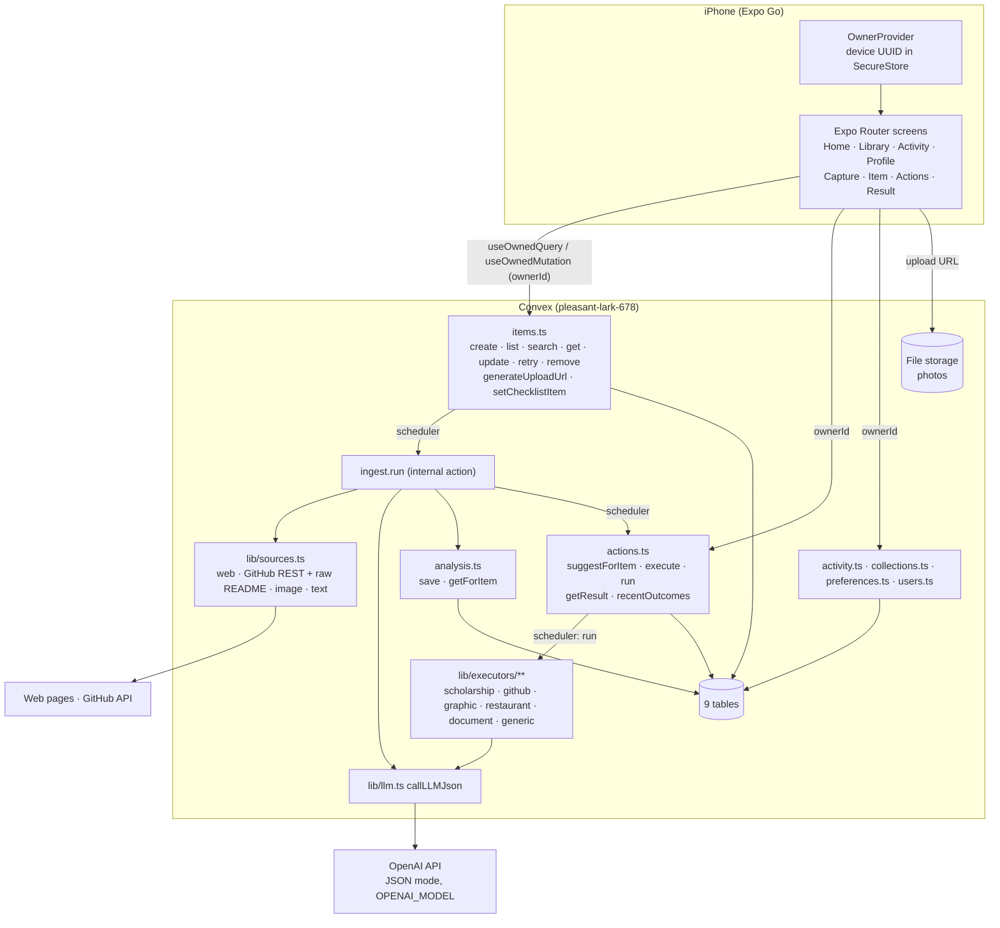
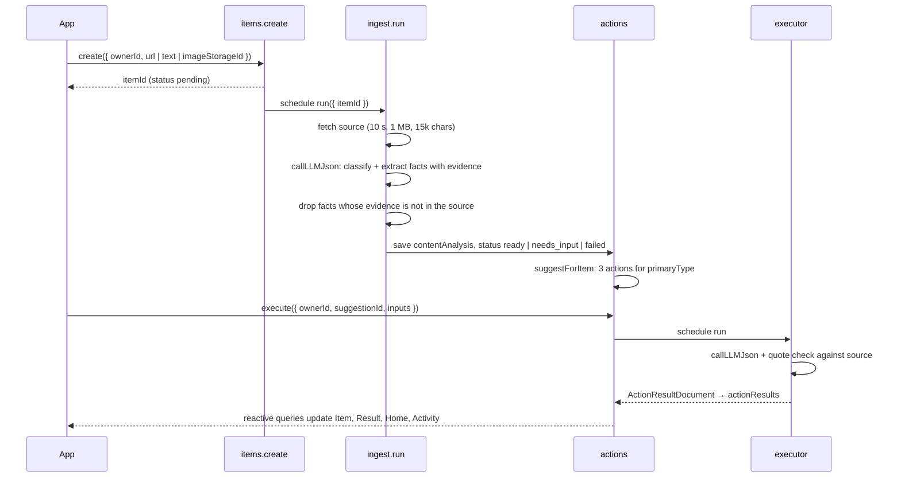
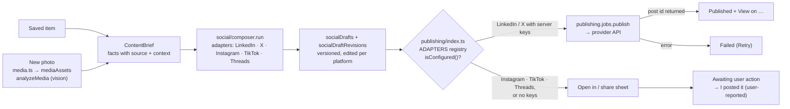

# Architecture

Zapy is one Expo Router app talking to one Convex deployment. All AI work, third-party fetching and publishing happen in Convex actions; the phone only calls Convex queries and mutations.

## Overview

## Save → Understand → Act

## Data model

| Table | Holds |
| --- | --- |
| `users` | one row per device ownerId |
| `savedItems` | the save: source URL / text / image, title, summary, content types, status, key facts |
| `contentAnalysis` | the full analysis with facts, evidence and missing info |
| `actionSuggestions` | the three contextual actions per item, with required inputs |
| `actionExecutions` | each run: queued → running → succeeded / failed |
| `actionResults` | the result document (checklists, steps, lists, key-value, text), warnings, sources |
| `collections` | collections, including the Moodboard |
| `activityEvents` | saved, analyzed, failed, action completed, … |
| `userPreferences` | Profile fields used by eligibility and visit planning |

Phase 2 tables are on main, defined in `convex/social/schema.ts` and spread into `convex/schema.ts`:

| Table | Holds |
| --- | --- |
| `socialDrafts` | latest draft per platform per source: draftText, structured output, provenance (facts used), `generationStatus`, publishing `status`, revision |
| `socialDraftRevisions` | every revision of a draft (generated, regenerated, user_edit) |
| `mediaAssets` | uploaded photos/videos with optional context and image analysis |
| `platformConnections` | per-platform connection state, no tokens (in the schema, not written yet) |
| `publishingJobs` | a share or publish attempt per draft, with an idempotency key |
| `publishingResults` | outcome per job: published, failed, not_connected or user_reported_shared |

## Rules the code follows

- **Ownership:** every public function takes `ownerId` and resolves it through `convex/lib/auth.ts` (`requireUser`, `requireOwnedItem`, `requireOwned`). Another device's ids return "Not found".
- **OpenAI server-side only:** the key lives on the deployment (`OPENAI_API_KEY`), the model comes from `OPENAI_MODEL` (gpt-5.4-mini on dev), and responses are JSON.
- **No fabrication:** facts carry evidence quotes checked against the fetched text; executors drop unverified items and add a warning. Deadlines are tracked only when found in the source.
- **Contracts:** shared shapes live in `src/shared/contracts.ts` (Phase 2: `src/shared/socialContracts.ts`); changes are additive only.
- **Shared dev deployment:** `npx convex dev --once` replaces every function, so deploys run only from a clean checkout of `origin/main`, after merge.

## Social Studio (Phase 2, shipped)

**Drafts** (`convex/social/drafts.ts`, every public function takes `ownerId`):

- `generate({ itemId | mediaId, platforms, context?, tone?, audience? })` inserts one draft per platform with `generationStatus: "generating"` and schedules `internal.social.composer.run`, which builds a ContentBrief and runs each platform adapter in `convex/social/adapters/**`.
- `listForSource`, `listRecent`, `get` (with revisions) read drafts.
- `update` stores a user edit as a new revision; `regenerate` writes a new revision on that one draft only; `restoreRevision` copies an old revision forward.
- `recommendPlatforms` returns platforms with a reason, recommended first.

**Photos** (`convex/media.ts`): `generateUploadUrl` → `createMediaAsset` → `analyzeMedia` (vision via `callLLMJson`, saved on the `mediaAssets` row) → `social.drafts.generate({ mediaId })`.

**Publishing** (`convex/publishing/**`):

- `index.ts` holds the adapter registry `ADAPTERS = { x, linkedin }`. Each `PublishAdapter` has `isConfigured()` and `publish(text, opts)`. LinkedIn (`linkedin.ts`) is configured by `LINKEDIN_ACCESS_TOKEN` (optional `LINKEDIN_PERSON_URN`); X (`x.ts`, OAuth 1.0a) needs `X_API_KEY`, `X_API_SECRET`, `X_ACCESS_TOKEN` and `X_ACCESS_TOKEN_SECRET`. Platforms without an adapter (Instagram, TikTok, Threads) always use the share sheet.
- `jobs.ts`: `publish` (action) runs `beginPublish` → adapter → `finishPublish`, idempotent per draft revision; `finishPublish` refuses `published` without a provider post id. `startShare`, `markReadyToShare`, `confirmUserPosted` (recorded as `user_reported_shared`, never Published) and `markFailed` cover the share-sheet path. `statusForDraft`, `listForSource` and `connectedAccounts` (booleans from `isConfigured()`, never secrets) feed the UI.
- `testPost.ts`: `sendTestPost` posts "Testing Zapy <time>" through a configured adapter for Profile → Connected accounts → Send test post. On dev, LinkedIn is configured and a real test post succeeded (`urn:li:share:7527842989080018944`); X stays in share-sheet mode until its keys are set.
- Each attempt writes `publishingJobs` and `publishingResults`. The `platformConnections` table exists in the schema but nothing writes it yet; connection state comes from the registry.

Composer progress (`generationStatus`) and publishing state (`status`: Draft, Ready to share, Awaiting user action, Publishing, Published, Failed) are separate fields.

**Screens:** the Create tab (`src/components/studio/StudioHome.tsx`) and Create post on item detail lead to `src/app/studio/platforms.tsx` (Where to post) → `editor.tsx` (per-platform tabs, Save edit, Rewrite, Copy, Preview, Share) → `preview.tsx`; `studio/photo` is the photo flow; `src/components/publishing/**` holds the publish sheet, connected accounts and test-post sheet.
