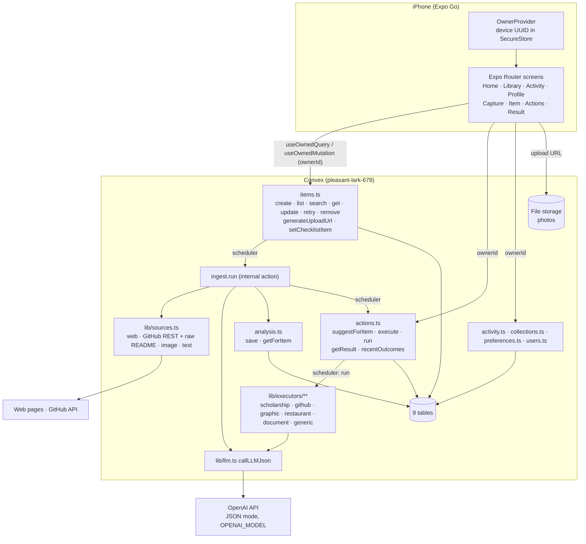
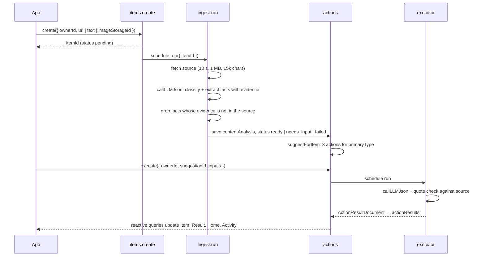
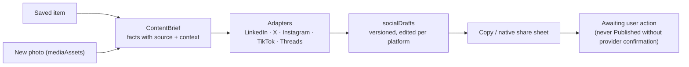

# Architecture

Zapy is one Expo Router app talking to one Convex deployment. All AI work and all third-party fetching happen in Convex actions; the phone only calls Convex queries and mutations.

## Overview

## Save → Understand → Act

## Data model

| Table | Holds |
| --- | --- |
| `users` | one row per device ownerId |
| `savedItems` | the save: source URL / text / image, title, summary, content types, status, key facts |
| `contentAnalysis` | the full analysis with facts, evidence and missing info |
| `actionSuggestions` | the three contextual actions per item, with required inputs |
| `actionExecutions` | each run: queued → running → succeeded / failed |
| `actionResults` | the result document (checklists, steps, lists, key-value, text), warnings, sources |
| `collections` | collections, including the Moodboard |
| `activityEvents` | saved, analyzed, failed, action completed, … |
| `userPreferences` | Profile fields used by eligibility and visit planning |

Phase 2 tables are on main, defined in `convex/social/schema.ts` and spread into `convex/schema.ts`:

| Table | Holds |
| --- | --- |
| `socialDrafts` | latest draft per platform per source: draftText, structured output, provenance (facts used), `generationStatus`, publishing `status`, revision |
| `socialDraftRevisions` | every revision of a draft (generated, regenerated, user_edit) |
| `mediaAssets` | uploaded photos/videos with optional context and image analysis |
| `platformConnections` | per-platform connection state, no tokens (all not_connected today) |
| `publishingJobs` | a share or publish attempt per draft, with an idempotency key |
| `publishingResults` | outcome per job: published, failed, not_connected or user_reported_shared |

## Rules the code follows

- **Ownership:** every public function takes `ownerId` and resolves it through `convex/lib/auth.ts` (`requireUser`, `requireOwnedItem`, `requireOwned`). Another device's ids return "Not found".
- **OpenAI server-side only:** the key lives on the deployment (`OPENAI_API_KEY`), the model comes from `OPENAI_MODEL` (gpt-5.4-mini on dev), and responses are JSON.
- **No fabrication:** facts carry evidence quotes checked against the fetched text; executors drop unverified items and add a warning. Deadlines are tracked only when found in the source.
- **Contracts:** shared shapes live in `src/shared/contracts.ts` (Phase 2: `src/shared/socialContracts.ts`); changes are additive only.
- **Shared dev deployment:** `npx convex dev --once` replaces every function, so deploys come from `origin/main` merged with every in-flight Convex branch.

## Social Studio (Phase 2, in progress)

API on main (`convex/social/drafts.ts`, every function takes `ownerId`):

- `generate({ itemId | mediaId, platforms, context?, tone?, audience? })` inserts one draft per platform with `generationStatus: "generating"` and schedules the composer.
- `listForSource`, `listRecent`, `get` (with revisions) read drafts.
- `update` stores a user edit as a new revision; `regenerate` writes a new revision on that one draft only; `restoreRevision` copies an old revision forward.
- `recommendPlatforms` returns platforms with a reason, recommended first.

Composer progress (`generationStatus`) and publishing state (`status`, owned by J) are separate fields.

TODO (Captain): add J's publishing functions and K's screens once they merge.
