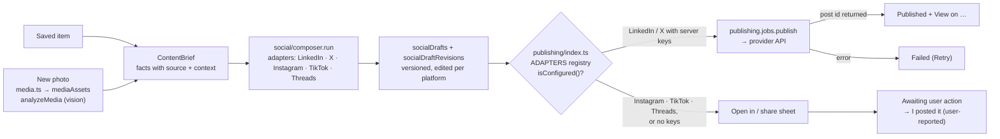

# Architecture

Zapy is one Expo Router app talking to one Convex deployment (\`pleasant-lark-678\`). All AI work, third-party calls (E2B, Browserbase, Composio, X, GitHub, LinkedIn) and publishing happen in Convex actions; the phone only calls Convex queries, mutations and a few public actions, always with its device \`ownerId\`. This page goes deeper than the README's [Architecture](../README.md#architecture) section, which has the data-model table, the API map and the external-services table. Checked against \`origin/main\` at \`71a633d\`.

## Overview

\`\`\`mermaid
flowchart TB
  subgraph Phone["Phone (Expo Go)"]
    Owner["OwnerProvider device UUID in SecureStore"]
    Screens["Expo Router screens welcome · pull · Home (Your tasks) · You item · actions · result · fill · studio · capture · import"]
    Owner --> Screens
  end

  subgraph Convex["Convex (pleasant-lark-678)"]
    Items["items.ts · demo.ts create · list · search · pullEverything · pullStatus · primaryAction"]
    Ingest["ingest.run (internal action)"]
    Sources["lib/sources.ts web · GitHub REST + raw README · image · text"]
    Analysis["analysis.ts"]
    Actions["actions.ts + lib/actionCatalog.ts suggestForItem · execute · run"]
    Executors["lib/executors/** scholarship · github · graphic · restaurant · generic"]
    Agents["agentRuns + agentMode (E2B) formFill + formFillAgent (Browserbase) agents/calendar (Composio)"]
    Imports["imports/** X bookmarks · GitHub stars · YouTube · syncAll"]
    Social["social/** · media.ts · publishing/**"]
    HTTP["http.ts OAuth callbacks · /save · /demo/*"]
    LLM["lib/llm.ts callLLMJson"]
    DB[("23 tables · file storage · search index")]
  end

  OpenAI["OpenAI (JSON, OPENAI_MODEL)"]
  Ext["Web · GitHub · X · LinkedIn"]
  Svc["E2B · Browserbase · Composio"]

  Screens -- "useOwnedQuery / useOwnedMutation (ownerId)" --> Items
  Screens -- "ownerId" --> Actions
  Screens -- "ownerId" --> Agents
  Screens -- "ownerId" --> Imports
  Screens -- "ownerId" --> Social
  Items -- "scheduler" --> Ingest
  Ingest --> Sources --> Ext
  Ingest --> LLM
  Ingest --> Analysis
  Ingest -- "scheduler" --> Actions
  Actions -- "scheduler: run" --> Executors --> LLM --> OpenAI
  Agents --> Svc
  Imports --> Ext
  Imports -- "importBatch → ingest" --> Ingest
  HTTP --> Imports
  Items --> DB
  Actions --> DB
  Agents --> DB
\`\`\`

## Navigation on main

\`src/app/_layout.tsx\` wraps everything in \`ConvexProvider\` and \`OwnerProvider\` and plays the ZapIntro. The dock (\`src/app/(tabs)/_layout.tsx\`, \`InkTabBar\`) shows two tabs, **Home** (\`index\`) and **You** (\`profile\`). \`library\`, \`create\` and \`activity\` are registered with \`href: null\`, so the routes exist but the dock hides them. Home sends a device that hasn't onboarded to \`/welcome\` (Start → About you → Complete your account → Connect your calendar), which ends at \`/pull\`.

## Save → Understand → Act

\`\`\`mermaid
sequenceDiagram
  participant U as App
  participant I as items.create / demo.pullEverything
  participant G as ingest.run
  participant A as actions
  participant X as executor
  U->>I: create({ ownerId, url | text | imageStorageId })
  I-->>U: itemId (status pending)
  I->>G: schedule run({ itemId })
  G->>G: fetch source (10 s, 1 MB, 15k chars)
  G->>G: callLLMJson: classify + extract facts with evidence
  G->>G: drop facts whose evidence is not in the source
  G->>A: save contentAnalysis, status ready | needs_input | failed
  A->>A: suggestForItem: 3 actions from CATALOG_ROUTING
  U->>A: execute({ ownerId, suggestionId, inputs })
  A->>X: schedule run
  X->>X: callLLMJson + quote check against source
  X-->>A: ActionResultDocument → actionResults
  A-->>U: reactive queries update Home, item and result
\`\`\`

## Demo flow and boxes

- \`demo.pullEverything\` (\`convex/demo.ts\`) seeds the four v2 demo saves from \`convex/lib/demo.ts\` (\`v2:repo\` → \`github.com/zubair480/zapy-hello-world\`, \`v2:camp\` and \`v2:scholarship\` → \`/demo/apply?program=…\`, \`v2:summit\` → \`/demo/post/nurses-summit\`), idempotent per owner through \`demoKey\`. It re-queues demo saves stuck in needs_input/failed, removes v1 demo saves, and calls \`scheduleImportSyncs\` for X and GitHub.
- \`demo.pullStatus\` counts analyzed saves per box; \`boxFor\` maps a content type to Code, Forms, Events, Jobs, Learn or Other (display copy in \`src/lib/boxes.ts\`).
- \`demo.primaryAction\` returns the agent action for an item via \`primaryAgentAction\`: \`github_repository\` → run_repo, \`application\`/\`scholarship\` → fill_form, \`event\` → calendar.

## Agent actions

Each one is a public mutation that checks ownership and schedules an internal action, and each one that writes to the outside world stops for approval first.

| Action | Start | Worker | Approval |
| --- | --- | --- | --- |
| Run it for me | \`agentRuns.startRunRepo\` creates a \`run_repo\` \`actionExecutions\` row | \`agentMode.runRepo\` ("use node"): E2B \`Sandbox.create\` (5 min), clone, install, run start/test script; \`lib/runRepo.ts\` builds the result (terminal transcript) | Tap-to-run; public repos, sandboxed |
| Fill it for me | \`formFill.start\` inserts \`formFillRuns\` (queued) | \`formFillAgent.run\`: Browserbase session + Stagehand fill, \`lib/formGuard.ts\` refuses submit/login instructions, screenshots to file storage, then \`needs_approval\` with \`expiresAt\` (8 min hold) | \`formFill.approve\` sets \`approved\`; the agent polls \`getStatus\` every 3 s and clicks Submit **only on the hosted \`/demo/apply\`** form (→ \`submitted\`). Elsewhere the user submits in the live view. If Browserbase can't start on the demo form, values are drafted from the profile and POSTed after approval. |
| Add to my calendar | \`agents/calendar.prepare\` writes an \`agentJobs\` proposal (\`needs_approval\`), date from the source via \`eventTiming\` | \`agents/calendar.execute\` → Composio \`GOOGLECALENDAR_CREATE_EVENT\` | Only \`calendar.approve\` schedules \`execute\`; an empty date blocks approval. \`updateProposal\`, \`cancel\`, \`retry\` exist. |

Google Calendar connect: \`calendar.startConnect\` returns a Composio link; Composio returns to \`/composio/callback\`, which 302s to an allow-listed app deep link with \`gcal=connected|error\`.

## Imports

- **X bookmarks:** \`imports.connections.startXConnect\` saves a PKCE state in \`importOAuthStates\` and returns the authorize URL; \`/oauth/x/callback\` runs \`completeXConnect\` (token exchange, tokens in \`importConnections\`) and returns to the app through a 200 page with a "Return to Zapy" button (Android Custom Tabs refuse 302s to custom schemes). \`syncX\` pages bookmarks and calls \`imports.posts\` to create saves, deduped by \`importedPosts\`.
- **GitHub stars:** \`imports.github.sync\` reads a username's stars (no token) into \`github_repository\` saves.
- **Auto-sync:** \`imports.sync.syncAll\` schedules \`syncX\` / \`github.sync\` for whatever the owner set up. Home calls it on focus/foreground (throttled to once a minute per device) and on pull-to-refresh; \`pullEverything\` calls the same helper. There are no crons (#68 was reverted in #74).
- **YouTube liked videos:** backend and \`/oauth/google/callback\` exist; the Import screen does not list YouTube.
- **Share to Zapy:** \`POST /save\` with a bearer share token (\`users.shareToken\`), 30/min per user (\`shareRateLimits\`). The token card component is not mounted in the current UI.

## Rules the code follows

- **Ownership:** every public function takes \`ownerId\` and resolves it through \`convex/lib/auth.ts\` (\`requireUser\`, \`requireOwnedItem\`, \`requireOwned\`). Another device's ids return "Not found".
- **OpenAI server-side only:** the key lives on the deployment (\`OPENAI_API_KEY\`), the model comes from \`OPENAI_MODEL\` (default \`gpt-4.1-mini\` in \`convex/lib/llm.ts\`; gpt-5.4-mini on dev), and responses are JSON.
- **No fabrication:** facts carry evidence quotes checked against the fetched text; executors drop unverified items and add a warning. Deadlines are tracked only when found in the source.
- **Contracts:** shared shapes live in \`src/shared/contracts.ts\` (Social Studio: \`src/shared/socialContracts.ts\`); changes are additive only.
- **Shared dev deployment:** \`npx convex dev --once\` replaces every function, so deploys run only from a clean checkout of \`origin/main\`, after merge.

## Social Studio and publishing

**Drafts** (`convex/social/drafts.ts`, every public function takes `ownerId`):

- `generate({ itemId | mediaId, platforms, context?, tone?, audience? })` inserts one draft per platform with `generationStatus: "generating"` and schedules `internal.social.composer.run`, which builds a ContentBrief and runs each platform adapter in `convex/social/adapters/**`.
- `listForSource`, `listRecent`, `get` (with revisions) read drafts.
- `update` stores a user edit as a new revision; `regenerate` writes a new revision on that one draft only; `restoreRevision` copies an old revision forward.
- `recommendPlatforms` returns platforms with a reason, recommended first.

**Photos** (`convex/media.ts`): `generateUploadUrl` → `createMediaAsset` → `analyzeMedia` (vision via `callLLMJson`, saved on the `mediaAssets` row) → `social.drafts.generate({ mediaId })`.

**Publishing** (`convex/publishing/**`):

- `index.ts` holds the adapter registry `ADAPTERS = { x, linkedin }`. Each `PublishAdapter` has `isConfigured()` and `publish(text, opts)`. LinkedIn (`linkedin.ts`) is configured by `LINKEDIN_ACCESS_TOKEN` (optional `LINKEDIN_PERSON_URN`); X (`x.ts`, OAuth 1.0a) needs `X_API_KEY`, `X_API_SECRET`, `X_ACCESS_TOKEN` and `X_ACCESS_TOKEN_SECRET`. Platforms without an adapter (Instagram, TikTok, Threads) always use the share sheet.
- `jobs.ts`: `publish` (action) runs `beginPublish` → adapter → `finishPublish`, idempotent per draft revision; `finishPublish` refuses `published` without a provider post id. `startShare`, `markReadyToShare`, `confirmUserPosted` (recorded as `user_reported_shared`, never Published) and `markFailed` cover the share-sheet path. `statusForDraft`, `listForSource` and `connectedAccounts` (booleans from `isConfigured()`, never secrets) feed the UI.
- `testPost.ts`: `sendTestPost` posts "Testing Zapy <time>" through a configured adapter for the Connected accounts card (no longer mounted on the You tab). On dev, LinkedIn is configured and a real test post succeeded (`urn:li:share:7527842989080018944`); X stays in share-sheet mode until its keys are set.
- Each attempt writes `publishingJobs` and `publishingResults`. The `platformConnections` table exists in the schema but nothing writes it yet; connection state comes from the registry.

Composer progress (`generationStatus`) and publishing state (`status`: Draft, Ready to share, Awaiting user action, Publishing, Published, Failed) are separate fields.

**Screens:** Create post on item detail (and the hidden Create route, `src/components/studio/StudioHome.tsx`) lead to `src/app/studio/platforms.tsx` (Where to post) → `editor.tsx` (per-platform tabs, Save edit, Rewrite, Copy, Preview, Share) → `preview.tsx`; `studio/photo` is the photo flow; `src/components/publishing/**` holds the publish sheet, connected accounts and test-post sheet.

**Reachability on main:** Studio opens from **Create post** on an item. The Create tab is hidden, and the Connected accounts / Send test post card was removed from the You tab (#107), so direct publishing has no visible entry point in the current UI. Instagram API publishing (#28) is frozen and not merged.
